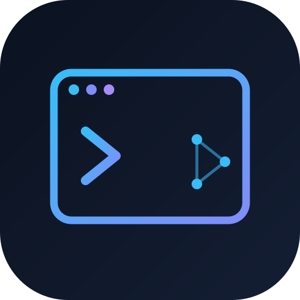

  
  <h1>lawyerch-dev</h1>
  
<strong>AI 工具与工程模板 · 做能跑、能交付的东西</strong>

  

    
    
    
  

---

## 在做什么

- **文档处理**：脱敏、OCR、格式转换
- **桌面应用**：Electron / Tauri 的工程化模板与打包发布
- **Agent 工具链**：MCP、Skills、浏览器扩展
- **开发资源**：动效、音效、图标、UI 的选型索引

## 公开项目

### [dev-resources](https://github.com/lawyerch-dev/dev-resources)

动效 / 音效 / 图标 / UI 的资源索引，含许可证标注与选型建议。收录 60+ 项目，全部 MIT / Apache-2.0 / BSD / CC0。

### [cc-ai-tools](https://github.com/lawyerch-dev/cc-ai-tools)

基于 ZTools 的可扩展应用启动器与插件平台，支持自定义插件市场。

### [cc-md-editor](https://github.com/lawyerch-dev/cc-md-editor)

基于 md.doocs 二次开发的 Markdown 编辑器。

## 从这里开始

- 找开发资源 → [`dev-resources`](https://github.com/lawyerch-dev/dev-resources)
- 看桌面端工程实践 → [`cc-ai-tools`](https://github.com/lawyerch-dev/cc-ai-tools)
- 看编辑器实现 → [`cc-md-editor`](https://github.com/lawyerch-dev/cc-md-editor)

## 原则

- **能跑优先**：README 首段写清怎么启动
- **依赖克制**：能用标准库就不引框架
- **只开源成熟的**：进行中与商业项目保持私有
- **许可证清晰**：公开项目必须标明许可证